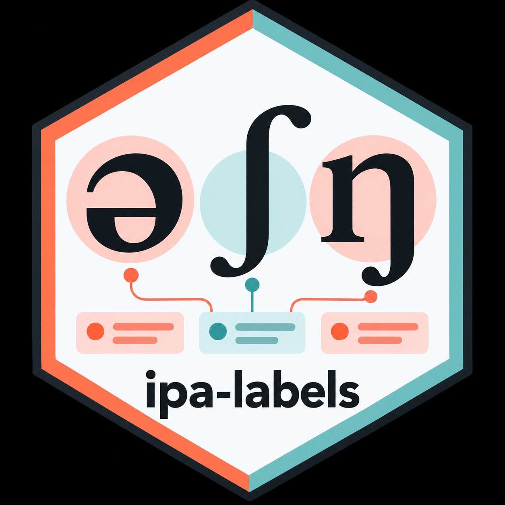
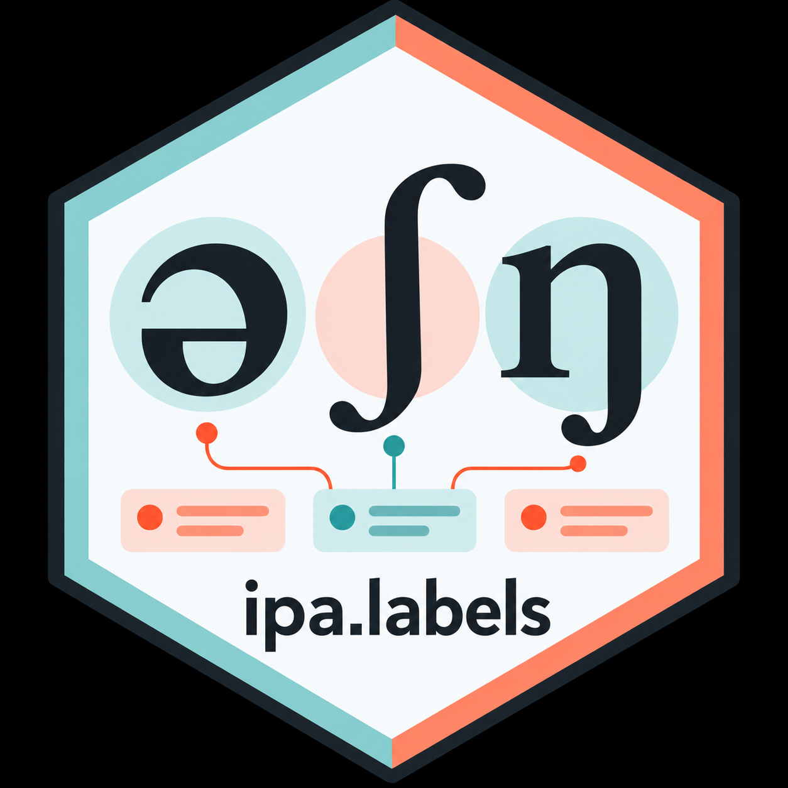

<h1 align="center">ipa-labels / ipa.labels</h1>

<table align="center">
  <tr>
    <td align="center">
      <br>
      <strong>Python</strong><br>
      <code>ipa_labels</code>
    </td>
    <td align="center">
      <br>
      <strong>R</strong><br>
      <code>ipa.labels</code>
    </td>
  </tr>
</table>

<p align="center"><strong>Comprehensive information about IPA symbols, in R and Python.</strong></p>

<p align="center">
  <a href="docs/python/index.html">Python documentation</a> ·
  <a href="docs/r/index.html">R documentation</a> ·
  <a href="python_package/TUTORIAL.md">Beginner's tutorial</a>
</p>

**An all-in-one IPA reference, not just a symbol chart.** `ipa-labels` brings together detailed information about International Phonetic Alphabet (IPA) symbols that would otherwise be scattered across reference charts, character-code tables and phonological databases. Its goal is to provide as complete a reference as possible for each IPA symbol, from articulatory descriptions and official names to Unicode values, transcription codes and phonological features.

Available as both an **R package** and a **Python package**, `ipa-labels` is designed for phoneticians, linguists, speech researchers, educators and students.

> [!NOTE]
> **This project is currently in beta and under active development.** The package is already usable, but some features, interfaces and documentation may change in future updates.

## What can you find?

| Information | Examples |
| --- | --- |
| **IPA symbols and labels** | Symbol, IPA name and number, descriptive label and symbol category |
| **Articulatory properties** | Voicing, place and manner of articulation; vowel height, frontness and roundedness |
| **Character and transcription codes** | Unicode name and block, hexadecimal and decimal values, TIPA, AFII, SAMPA/X-SAMPA and ARPABET (where available) |
| **Phonological features** | PHOIBLE segment features, such as *consonantal*, *labial* and *nasal* |
| **Language inventories** | PHOIBLE phoneme inventories, languages, sources and segment membership |

Information is organised into five groups for each symbol: `symbol`, `code`, `label`, `features` and `description`. A simpler field-based lookup interface is also available. Some properties and mappings do not apply to every symbol; missing information is retained as missing rather than inferred.

## Installation

Both packages can be installed directly from this GitHub repository. You will need Git for the Python installation method below.

### Python

Run in a terminal:

```bash
python -m pip install "git+https://github.com/congzhang365/IPA_labels.git#subdirectory=python_package"
```

Then import the package:

```python
import ipa_labels
```

### R

Run in R:

```r
if (!requireNamespace("remotes", quietly = TRUE)) {
  install.packages("remotes")
}

remotes::install_github("congzhang365/IPA_labels", subdir = "r_package/ipa.labels")
```

Then load the package:

```r
library(ipa.labels)
```

## Quick examples

### Python

```python
import ipa_labels

# Get information about an individual symbol
p = ipa_labels.get("p")
print(p.label.full)          # voiceless bilabial plosive
print(p.label.place)         # bilabial
print(p.code.unicode)        # U+0070
print(p.features.labial)     # True

# Find symbols matching phonetic properties
ipa_labels.lookup(
    type="vowel", frontness="front", roundedness="rounded",
    fields="symbol"
)

# Explore PHOIBLE inventories
english = ipa_labels.inventory(language="English")
```

### R

```r
library(ipa.labels)

# Get information about an individual symbol
p <- ipaget("p")
p$label$full                  # voiceless bilabial plosive
p$label$place                 # bilabial
p$code$unicode                # U+0070
p$features$labial             # TRUE

# Find symbols matching phonetic properties
ipalookup(
  type = "vowel", frontness = "front", roundedness = "rounded",
  fields = "symbol"
)

# Explore PHOIBLE inventories
english <- ipainventory(iso639_3 = "eng")
```

Both packages also support free-text search: `ipa_labels.query()` in Python and `ipaquery()` in R.

For detailed arguments, more examples and the full field list, see the [Python manual](docs/python/index.html), [R manual](docs/r/index.html) and [beginner's tutorial](python_package/TUTORIAL.md).

## Data sources and scope

The core symbol descriptions and codes draw primarily on International Phonetic Association reference materials, supplemented by symbol-code tables and cross-checked against additional IPA references. Phonological features and language inventories use a versioned PHOIBLE 2.0.1 snapshot. These sources provide complementary information and may differ in coverage or terminology.

Data provenance is recorded in the generated package metadata. `ipa-labels` is an independent software project and is not an official package of the International Phonetic Association or PHOIBLE.

## How to cite

If you use `ipa-labels` in your research, teaching or software, please cite:

> Zhang, C. (2026). *ipa-labels: A comprehensive IPA symbol reference for R and Python* [Computer software]. GitHub. [Project repository](https://github.com/congzhang365/IPA_labels).

This is a provisional citation; version and archival identifier details may be added in a future release. If you use PHOIBLE-derived features or inventory data, please also cite PHOIBLE and, where appropriate, the original inventory sources.

## References

**Primary IPA symbol information**

- International Phonetic Association. [IPA symbol list in unitipa (PDF)](https://www.internationalphoneticassociation.org/IPAcharts/common_files/pdfs/pdfs_IPA_charts_E/IPA_unitipa_sl.pdf).
- [Phonetic symbols and Unicode character information (PDF)](https://www.internationalphoneticassociation.org/sites/default/files/phonsymbol.pdf).

**Character codes, features and inventories**

- [IPA symbols with Unicode decimal and hexadecimal codes](https://www.internationalphoneticalphabet.org/ipa-charts/ipa-symbols-with-unicode-decimal-and-hex-codes/).
- Moran, S., & McCloy, D. (Eds.). (2019). [PHOIBLE 2.0](https://phoible.org/). Max Planck Institute for the Science of Human History. [Archived release](https://doi.org/10.5281/zenodo.2626687).

**Additional sources used for cross-checking**

- [IPA Symbol Equivalents](https://writingsystems.info/articlelib/i/ipa-symbol-equivalents/), Writing Systems Technical Resources.
- Hagiwara, R. (2002). [Reference chart for IPA typography, version 1.1 (PDF)](https://home.cc.umanitoba.ca/~robh/files/iparef11.pdf).
- [International Phonetic Alphabet (IPA) Chart in Unicode and XHTML/CSS](https://westonruter.github.io/ipa-chart/index.html).
